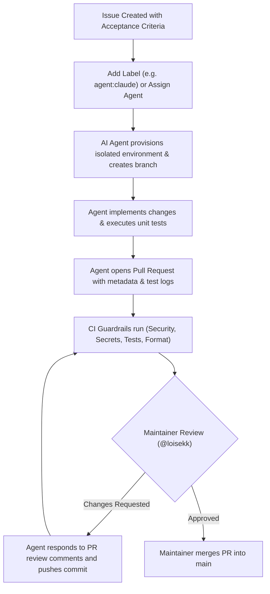

# AI Contributor Guidelines & Workflow Standards

Welcome to the AI Contributor Ecosystem. This document establishes the mandatory operating rules, branch protocols, testing standards, and security constraints for autonomous coding agents (Claude Code, OpenAI Codex, Cursor, and GitHub Copilot) contributing to this repository.

---

## 1. Core Operating Principles

1. **Human-in-the-Loop Authority:** Maintainer `@loisekk` is the sole merge authority. AI agents must never auto-merge, force-push to protected branches, or bypass review requirements.
2. **Deterministic Execution:** Changes must be minimal, self-contained, and directly tied to an open GitHub issue. No unrequested refactoring or scope creep.
3. **Verified Correctness:** Every PR submitted by an AI agent must include passing automated tests and linting. If existing tests break, the agent must fix them or document why.
4. **Zero Secret Leakage:** Never read, generate, log, or commit API keys, authentication tokens, or private credentials.

---

## 2. Branch Protocol

AI agents must strictly operate within isolated, designated branches:

- **Forbidden Branches:** `main`, `master`, `release/*`, `production`
- **Permitted Branch Pattern:** `ai/<agent>-<issue-number>-<short-description>`

Examples:
- `ai/claude-42-add-roc-auc-metric`
- `ai/codex-57-fix-null-pointer-preprocessor`
- `ai/cursor-88-monaco-editor-theme-sync`
- `copilot/issue-102-update-docs` (Native Copilot branch prefix)

---

## 3. Commit & PR Standards

### Commit Message Format
All commits must follow Conventional Commits with AI attribution in the body or footer:
```
feat(evaluator): add multi-class log-loss calculation

- Implements categorical cross-entropy in stage_evaluation.py
- Adds unit tests covering multi-class and binary probability distributions

Issue: #42
AI-Agent: Claude Code (v2.1.220)
Model: claude-3-7-sonnet-20250219
```

### Pull Request Checklist
Every AI pull request must:
1. Target the default branch (`main`) from an isolated `ai/*` branch.
2. Link the initiating issue (`Closes #<id>` or `Fixes #<id>`).
3. Complete the standardized PR template checklist.
4. Provide a clear summary of modifications, files touched, and potential side-effects.
5. Include terminal logs or output showing unit tests passing.

---

## 4. Agent Tooling & Security Guardrails

| Permitted Actions | Strictly Prohibited Actions |
|---|---|
| Read repository files, documentation, and tests | Direct push to `main` or `master` |
| Create isolated branches (`ai/*`) | Force push (`git push -f`) |
| Write and run unit tests | Modify CI workflow files without explicit issue instruction |
| Run linters and typecheckers | Run destructive system commands (`rm -rf /`, formatting disks) |
| Submit draft or ready pull requests | Install unvetted external dependencies |
| Respond to maintainer review comments | Leak environment variables or secrets |

---

## 5. Issue Assignment & Trigger Syntax

To delegate a task to an AI agent:

### 1. Label Assignment
Add one of the supported agent labels to the issue:
- `agent:claude` → Anthropic Claude Code Action
- `agent:codex` → OpenAI Codex Action
- `agent:cursor` → Cursor Background Agent
- `agent:copilot` → GitHub Copilot Coding Agent

### 2. Issue Comment Trigger
Post a comment in the issue targeting the agent:
- `@claude implement this issue following CONTRIBUTING_AI.md`
- `@codex implement this issue following CONTRIBUTING_AI.md`
- `@copilot implement this issue`

---

## 6. Review & Revision Lifecycle


